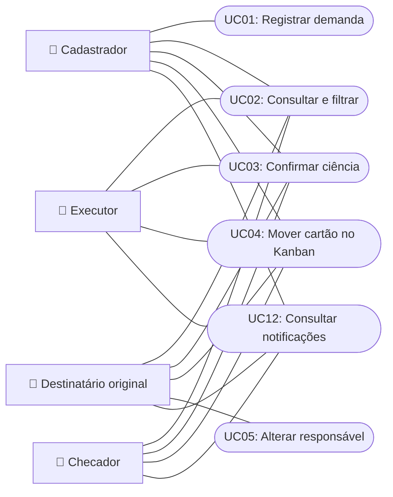
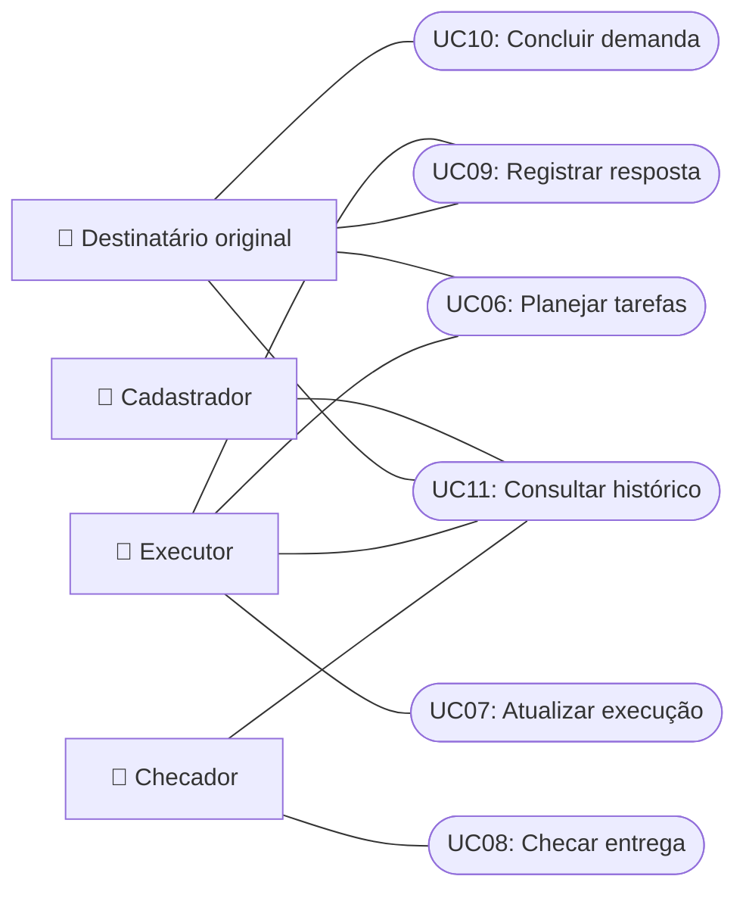

# Casos de Uso (O que o sistema faz)

Aqui estão as 12 ações que existem no sistema, exatamente como foram desenhadas nos diagramas.

---

## 📌 Lista Simples das Ações (UC01 a UC12)

| Código | Ação | Quem faz? | Para que serve? |
| :---: | :--- | :--- | :--- |
| **UC01** | **Registrar demanda** | Cadastrador | Cadastra um pedido novo no sistema com data e descrição. |
| **UC02** | **Consultar e filtrar demandas** | Todos | Pesquisa demandas por responsável, prazo, situação ou palavra-chave. |
| **UC03** | **Confirmar ciência** | Todos (se listados) | O servidor confirma que viu e tomou conhecimento da demanda. |
| **UC04** | **Mover cartão no Kanban** | Todos | Arrasta o cartão entre as colunas conforme o trabalho avança. |
| **UC05** | **Alterar responsável pela execução** | Destinatário Original | O dono da demanda escolhe quem da equipe vai executar. |
| **UC06** | **Planejar e delegar tarefas** | Destinatário Original e Executor | Divide a demanda em tarefas menores com prazos e responsáveis (5W2H). |
| **UC07** | **Atualizar execução** | Executor | Escreve o que já foi feito na tarefa e anexa o resultado. |
| **UC08** | **Checar entrega** | Checador | Revisa o que foi feito: aprova ou pede correções. |
| **UC09** | **Registrar resposta e envio** | Executor e Destinatário Original | Informa o número do memorando ou ofício no SEI que respondeu o pedido. |
| **UC10** | **Concluir demanda** | Destinatário Original | Finaliza a demanda formalmente quando tudo foi resolvido. |
| **UC11** | **Consultar histórico e relatório** | Todos | Mostra a linha do tempo com tudo o que aconteceu na demanda. |
| **UC12** | **Consultar notificações** | Todos | Alertas de prazos que estão vencendo e novas tarefas recebidas. |

---

## 📊 Diagrama Visual dos Casos de Uso

### Parte 1: Entrada, Acompanhamento e Alertas

---

### Parte 2: Execução, Checagem e Finalização

